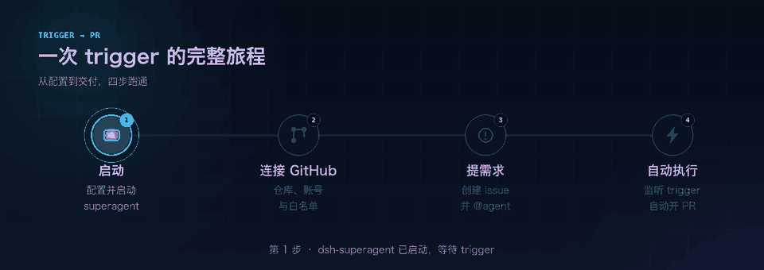

# super agent 探索

<p align="center">
  
</p>

<p align="center">
  
  
  
</p>

<p align="center">
  一个会自己接活、干活、交付的 GitHub agent。<br>
  在 issue 里 @ 它，剩下的交给 trigger。
</p>

> [!NOTE]
> 这是 [dsh-superagent](https://github.com/deepseek-ai/dsh-superagent-prototype) 的试用沙盒，用来验证「issue → trigger → 自动执行 → PR」这条链路，不是生产环境。

## 这是什么

`dsh-superagent` 是一个只服务单个 GitHub 仓库的主动式编码 agent：

- **接活**：监听 issue 里被允许的人对它的 @ 提及；
- **干活**：为每个请求建一个 ticket，在自己的目录里读代码、改代码、跑检查；
- **交付**：把改动推成分支、开 PR，再回到原 issue 回复。

它把「人盯人」换成「人定规则」：人只负责提需求和 review，中间过程由 agent 自己推进。

## 它是怎么跑起来的

<p align="center">
  
</p>

### 1. 配置并启动 superagent

用一个独立的 DSH profile 启动 dsh-superagent，让它和日常使用的 DSH 互不打扰。默认值大致是这样：

```text
profile   superagent
panel     http://127.0.0.1:3082
state     ~/.dsh/state/superagent
```

最省事的方式是让编码 agent 读仓库里的 [`SETUP.md`](https://github.com/deepseek-ai/dsh-superagent-prototype/blob/main/SETUP.md)：它会一次问一个问题，收齐答案后给出完整计划，再安装、配置并启动。

### 2. 配置 GitHub

在 Web 面板里保存 GitHub Source。几个关键项：

| 配置 | 作用 |
| --- | --- |
| Repository | agent 只在这个仓库里工作，例如 `owner/name` |
| Agent account | agent 的专用账号，它写下的所有内容都归这个账号 |
| Allowed logins | 只有名单里的人 @ 它才算数，其他人不会触发 |
| Executor checkout | 每个 ticket 从哪个本地 clone 拉工作区 |
| Prompts | 交付规则、commit 身份、是否启用 auto-merge |

保存后按提示重启，superagent 会加载新配置。

### 3. 创建 issue

在仓库里新建 issue，把需求写清楚，然后 `@agent-account`。

- 只有白名单账号的 mention 会被接受；bot 和陌生人的 @ 不会触发。
- 需求可以追加：同一条 thread 里的后续消息会作为上下文回到 ticket。

### 4. 监听 trigger，自动执行

watcher 收到 mention 后，链路大致是：

```text
issue comment
   └─ trigger
        └─ 评估 / 建 ticket
             └─ 独立目录开工
                  ├─ 读代码、改代码、跑检查
                  ├─ 推分支、开 PR
                  └─ 回到原 thread 回复
```

人收到的是「PR 已就绪」或「需要你决定」，而不是一堆中间状态。

## 内部机制

<p align="center">
  
</p>

几个关键设计：

- **一个 ticket 一个工作区**：worker 在自己的目录里干活，互不打扰。
- **订阅而不是轮询**：ticket 绑定到触发它的 thread，后续消息自动成为上下文。
- **少打扰**：只在有结果、有阻塞或需要人决定时才发消息。

## 一次真实试用

这篇 README 本身就是一次 trigger 的产物。

[issue #3](https://github.com/mixtbkig/superagent-lab/issues/3) 里先提出「美化排版、补动画、写清流程」，agent 接单后在独立目录里完成改动并开了 PR——你现在看到的标题、横幅、流程图和下面这些章节，都是那次执行的交付物。

| 阶段 | 发生了什么 |
| --- | --- |
| 提需求 | 在 issue 评论里 @agent |
| 接单 | trigger 被接收，建立 ticket |
| 执行 | worker 读仓库、生成 SVG/GIF、重写 README |
| 交付 | 推分支、开 PR、在原 thread 回复 |

## 目录

```text
.
├── README.md
└── assets/
    ├── banner.svg     # 顶部横幅（CSS 动画）
    ├── flow.gif       # 四步流程动画
    └── mechanism.svg  # 内部机制时序图
```

## 常见问题

**它会自己合并 PR 吗？**
默认不会。是否启用 auto-merge 是配置项，并且需要另一个有合并权限的账号。

**它会不会改错东西？**
改动都落在独立分支和 PR 上，合并前由人 review。

**支持飞书吗？**
dsh-superagent 支持 GitHub 与飞书两种 Source；这个沙盒目前只接了 GitHub。

## 相关：DeepSeek Harness 源码教程

仓库里附了一套面向初学者的 **DeepSeek Harness 源码深度教程**（21 章静态网页，含交互图示），从 Claude Code / Codex 这类 agent harness 切入，逐层讲到 Cordis 插件框架、Agent 循环、事件溯源会话、工具流水线、上下文压缩与多智能体编排，并附带 372 个包的完整全景。

- 入口：[`deepseek-harness-tutorial/index.html`](deepseek-harness-tutorial/index.html)（双击即可打开）
- 说明：[`deepseek-harness-tutorial/README.md`](deepseek-harness-tutorial/README.md)

## 参考

- [dsh-superagent](https://github.com/deepseek-ai/dsh-superagent-prototype)：设计与实现
- [DeepSeek Harness](https://www.deepseek.com/en/harness/)：运行环境

---

<p align="center"><sub>由 agent 在 issue #3 的 trigger 下完成 · 人来 review，人来 merge</sub></p>
